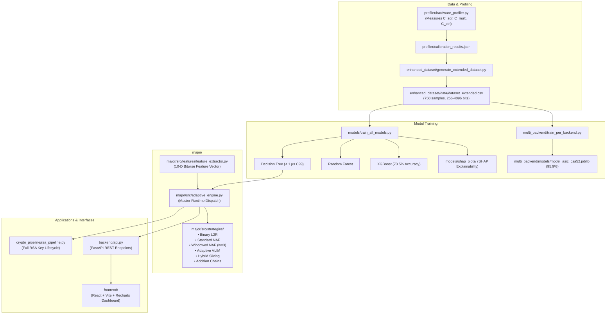

# Developer & Collaborator Guide
## ML-Assisted Adaptive Cryptographic Engine

**Authors:** Eric Dazzle George (23U01035) & Sourav Yadav (23U01074)  
**Department:** Electronics and Communication Engineering, IIIT Bhopal  
**Project Lead / Supervisor:** Dr. Aashish Parihar  

---

## 1. Architecture Overview & Data Flow

This repository houses both the **foundational theoretical research engine** (located in [`major/`](../major)) and the **production-grade operational infrastructure** (enhanced dataset, multi-model trainer, RSA lifecycle pipeline, hardware auto-profiler, multi-backend models, FastAPI REST service, and React dashboard).



---

## 2. Directory Structure & Module Responsibilities

| Directory | Purpose | Key Files |
| :--- | :--- | :--- |
| **[`major/`](../major/)** | Core research framework from thesis. Unchanged, pure mathematical foundations. | `src/adaptive_engine.py`, `src/features/feature_extractor.py`, `src/strategies/` |
| **[`crypto_pipeline/`](../crypto_pipeline/)** | Production RSA key lifecycle using the adaptive engine. | `rsa_pipeline.py`, `test_rsa_pipeline.py` |
| **[`enhanced_dataset/`](../enhanced_dataset/)** | Dataset generation extending up to 4096-bit RSA keys with 6 topological profiles. | `generate_extended_dataset.py`, `data/dataset_extended.csv` |
| **[`models/`](../models/)** | Multi-model training (DT, RF, XGBoost), C-compilation, and SHAP explainability. | `train_all_models.py`, `saved/`, `shap_plots/` |
| **[`profiler/`](../profiler/)** | CPU hardware micro-benchmarking engine to auto-calibrate cost model weights. | `hardware_profiler.py`, `calibration_results.json` |
| **[`multi_backend/`](../multi_backend/)** | Cross-architecture hardware models (Python, C-Montgomery, FPGA, ASIC CSA). | `backend_configs.py`, `train_per_backend.py`, `models/` |
| **[`backend/`](../backend/)** | High-performance FastAPI server exposing 10 REST endpoints. | `api.py`, `requirements_api.txt` |
| **[`frontend/`](../frontend/)** | Modern React + Vite dashboard with real-time charts and radar plots. | `src/App.jsx`, `src/components/`, `package.json` |
| **`run_all.sh`** | Unified master CLI orchestration script. | Execute any sub-pipeline with single command. |

---

## 3. Quick Start for Developers & Collaborators

### 3.1 Initial Environment Setup
```bash
# Clone the repository (if on a new system)
git clone https://github.com/sourav-official/major-project.git
cd major-project

# Initialize virtual environment and install all dependencies
bash run_all.sh setup
```

### 3.2 Running the Web Application
```bash
# Terminal 1: Launch FastAPI backend (http://localhost:8000)
bash run_all.sh api

# Terminal 2: Launch React frontend (http://localhost:3000)
bash run_all.sh frontend
```

### 3.3 Running Verification & Benchmarks
```bash
# Verify foundational mathematics
python3 major/test_sanity.py
python3 major/test_innovations.py

# Verify RSA key lifecycle (512, 1024, 2048-bit)
bash run_all.sh test-rsa

# Re-calibrate hardware cost coefficients on this CPU
bash run_all.sh profile

# Re-train models and generate SHAP plots
bash run_all.sh train
```

---

## 4. Key Python APIs & Developer Contracts

### 4.1 RSA Pipeline API (`crypto_pipeline/rsa_pipeline.py`)

```python
from crypto_pipeline.rsa_pipeline import RSAPipeline

# 1. Key Generation
pair = RSAPipeline.keygen(bits=2048)
pub, priv = pair.public, pair.private

# 2. Public Key Encryption (Uses ML-Adaptive mode)
enc = RSAPipeline.encrypt(message=123456789, pub=pub)
ciphertext = enc["ciphertext"]

# 3. Private Key Decryption (Uses Blinded-Adaptive mode, side-channel safe)
dec = RSAPipeline.decrypt(ciphertext=ciphertext, priv=priv)
assert dec["plaintext"] == 123456789

# 4. Text Signing & Verification (SHA-256)
sign_res = RSAPipeline.sign_text("Approved cryptographic message", priv=priv)
ver_res  = RSAPipeline.verify_text("Approved cryptographic message", sign_res["signature"], pub=pub)
assert ver_res["verified"] is True
```

### 4.2 Adaptive Engine API (`major/src/adaptive_engine.py`)

```python
from major.src.adaptive_engine import AdaptiveCryptoEngine

# Run with ML-Adaptive dispatch
res = AdaptiveCryptoEngine.execute(
    base=5,
    exp=65537,
    mod=1000000007,
    mode="ml_adaptive"  # Options: ml_adaptive, fixed_binary, fixed_naf, fixed_wnaf, fixed_vlim, hybrid_sliced, blinded_adaptive
)
print(f"Strategy: {res['selected_strategy']} | Result: {res['result']}")
```

### 4.3 Feature Extractor API (`major/src/features/feature_extractor.py`)

```python
from major.src.features.feature_extractor import extract_features

feats = extract_features(exp=0xDEADBEEFCAFE1234, w=3)
# Returns 10-dimensional dictionary:
# bit_length, hamming_weight, zero_density, longest_zero_run, avg_zero_run,
# longest_one_run, trailing_zeros, wnaf_weight, wnaf_zero_density, longest_wnaf_zero_run
```

---

## 5. How to Extend the Project

### 5.1 Adding a New Strategy
1. Open [`major/src/strategies/mod_exp_strategies.py`](../major/src/strategies/mod_exp_strategies.py).
2. Add your static method to `ModExpEngine` returning `{"result": res, "metrics": {...}}`.
3. Register your strategy name in `AdaptiveCryptoEngine.STRATEGY_MAP` in [`major/src/adaptive_engine.py`](../major/src/adaptive_engine.py).
4. Run `python3 major/test_sanity.py` to ensure mathematical equivalence against `pow(base, exp, mod)`.

### 5.2 Adding a New Target Hardware Backend
1. Open [`multi_backend/backend_configs.py`](../multi_backend/backend_configs.py).
2. Add your hardware entry to `BACKEND_CONFIGS`:
   ```python
   "riscv_vector_crypto": {
       "cost_sqr":  1.0,
       "cost_mult": 1.8,
       "cost_ctrl": 0.3,
       "description": "RISC-V Vector Cryptography Extension (RVV-Crypto) instruction backend."
   }
   ```
3. Run `bash run_all.sh backends` to train a dedicated Decision Tree for this backend.
4. Your new backend is immediately available in both the REST API and the React Dashboard!

---

## 6. Code Style & Contribution Protocol

* **Mathematical Invariance:** Any new strategy MUST assert `result == pow(base, exp, mod)` across random test vectors.
* **Side-Channel Discipline:** Private-key functions must utilize Euler totient blinding (`blinded_adaptive`) and must never use data-dependent branching on raw private exponent bits.
* **Path Resolution:** Always resolve the workspace root cleanly via:
  ```python
  ROOT = os.path.dirname(os.path.dirname(os.path.abspath(__file__)))
  sys.path.insert(0, ROOT)
  ```
